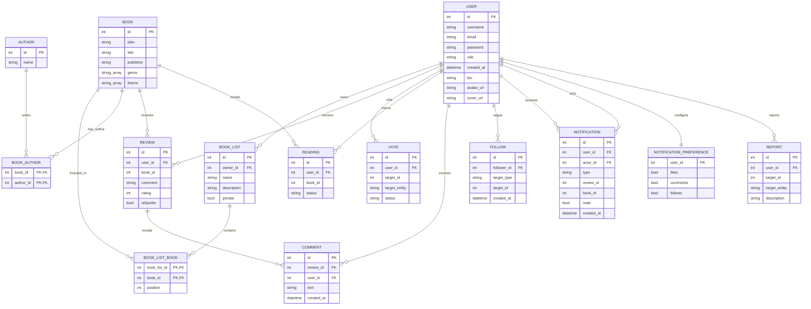

# Modelagem de Dados

## Diagrama Entidade-Relacionamento (DER)

Diagrama textual alinhado aos modelos SQLAlchemy e às migrations atuais:

## Entidades

| Entidade | Descrição | Campos principais |
| --- | --- | --- |
| **User** | Pessoa usuária do sistema | `id`, `username`, `email`, `password` (hash), `role` (padrão `user`), `created_at`, `bio`, `avatar_url`, `cover_url` (os três últimos opcionais) |
| **Book** | Livro, mangá ou quadrinho | `id`, `isbn`, `title`, `publisher`, `author` (multivalorado), `genre` (multivalorado), `theme` (multivalorado) |
| **BookList** | Lista de obras criada por um usuário | `id`, `owner_id`, `name`, `description`, `private` |
| **Review** | Avaliação de uma obra | `id`, `user_id`, `book_id`, `comment` (opcional), `rating` (1 a 5), `isSpoiler` |
| **Vote** | Like/dislike ou marcação em um conteúdo (a curtida de resenha usa `status: "like"` e alvo `reviews`) | `id`, `user_id`, `target_id`, `target_entity`, `status` |
| **Comment** | Comentário em uma resenha | `id`, `review_id`, `user_id`, `text` (até 500), `created_at` |
| **Follow** | Quem segue um usuário ou uma lista | `id`, `follower_id`, `target_type` (`users` ou `lists`), `target_id`, `created_at`; único por seguidor e alvo |
| **Notification** | Aviso de curtida, comentário ou novo seguidor | `id`, `user_id` (quem recebe), `actor_id`, `type`, `review_id`, `book_id`, `read`, `created_at` |
| **NotificationPreference** | Tipos de aviso que o usuário quer receber | `user_id`, `likes`, `comments`, `follows` |
| **Reading** | Status de leitura de uma obra por usuário | `id`, `user_id`, `book_id`, `status` (`want_to_read`, `reading`, `read`); único por usuário e obra |
| **Report** | Denúncia de conteúdo | `id`, `user_id`, `target_id`, `target_entity`, `description` |
| **BookListBook**, **BookAuthor** | Tabelas associativas (N:N) | `book_list_books` relaciona listas e obras; `book_author` relaciona obras e autores |

## Como o DER aparece no código

| Entidade | Entidade de domínio | Tabela (Alembic/SQLAlchemy) | Exposta na API |
| --- | --- | --- | --- |
| User | ✓ `domain/entities/user.py` | ✓ `users` | ✓ `/auth/*` |
| Book | ✓ `domain/entities/book.py` | ✓ `books`, `authors`, `book_author` | ✓ `/books` |
| BookList | ✓ `domain/entities/book_list.py` | ✓ `book_lists`, `book_list_books` | ✓ `/lists` |
| Review | ✓ `domain/entities/review.py` | ✓ `reviews` | ✓ `/reviews` |
| Vote | ✓ `domain/entities/vote.py` | ✓ `votes` | ✓ `/votes` |
| Comment, Follow, Notification, NotificationPreference | ✓ `domain/entities/social.py` | ✓ `comments`, `follows`, `notifications`, `notification_preferences` | ✓ `/reviews/{id}/comments`, `/follows`, `/notifications` |
| Reading | ✓ `domain/entities/reading.py` | ✓ `readings` | ✓ `/readings` |
| Report | ✓ `domain/entities/report.py` | ✓ `reports` | ✓ `/reports` |

`Report.target_entity` e `Report.target_id` formam uma referência polimórfica; `target_entity` é validado como texto, sem enum de tipos de alvo, e `target_id` não possui uma FK fixa. O autor (`user_id`) é obtido do token da sessão autenticada. `reports.user_id` também não declara uma FK para `users.id`, embora usuários sejam persistidos no PostgreSQL.

> `follows.target_id` é polimórfico (usuário ou lista), sem chave estrangeira. `votes.target_id` também não possui FK; `notifications.review_id` e `notifications.book_id` igualmente não declaram FKs.

> `reviews.book_id` e `readings.book_id` não declaram chave estrangeira para `books`, mesmo com as obras persistidas no PostgreSQL.

> O autor é normalizado em uma tabela própria (`authors`) ligada a `books` por `book_author`; gênero e tema são arrays e não possuem tabelas próprias.
